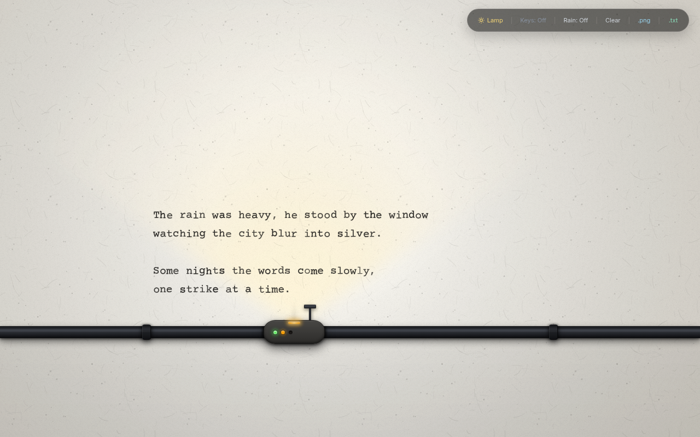
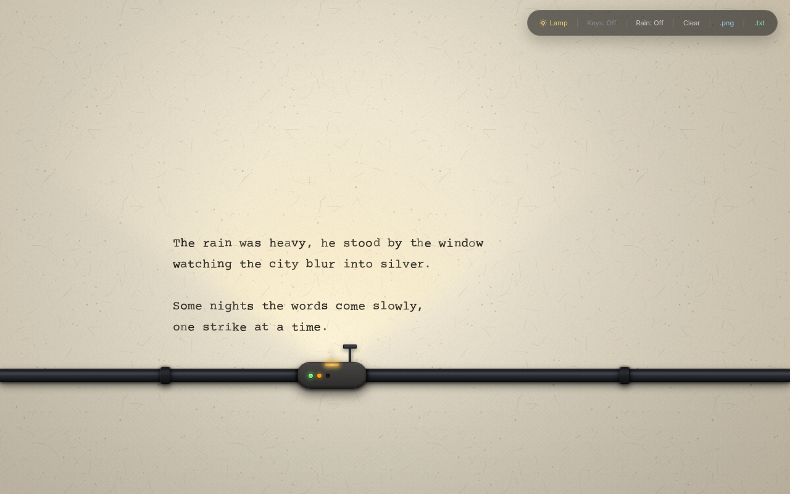
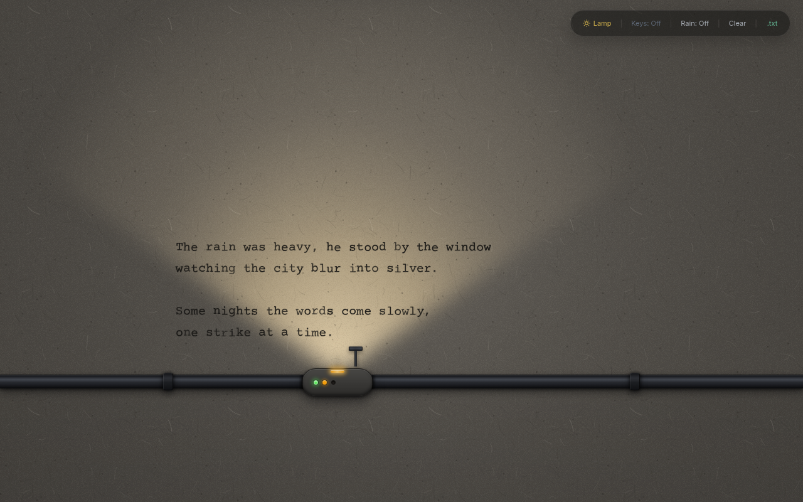
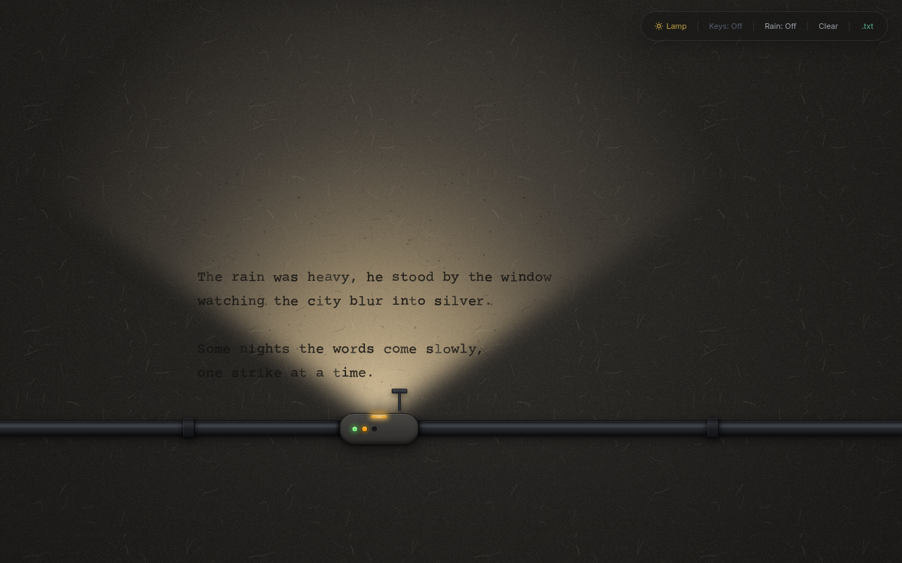
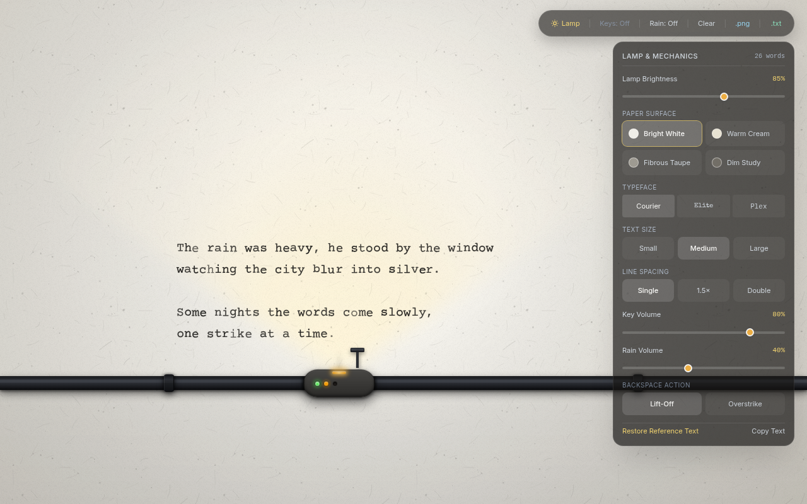
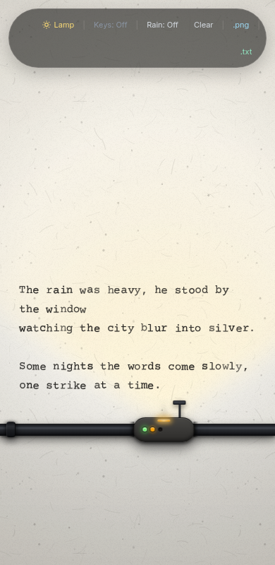

# LUMEN // Tactile Typewriter

A tactile web typewriter. It has a sliding carriage, a warm lamp that lights the page, ink that behaves like real ink, and mechanical sounds synthesised in the browser with no audio files.

**Live demo:** https://tanvir-cpp.github.io/monotype/



---

## Features

- **Realistic typing**
  - Strike pressure depends on the character: periods are light, `M` and `W` hit hard.
  - Every letter has a faint ink halo and sits slightly differently, like a worn typebar.
  - The paper shudders on each strike.
- **Warm lamp:** a volumetric cone of light follows the carriage across the page.
- **Four paper surfaces:** Bright White (default), Warm Cream, Fibrous Taupe and Dim Study.
- **Two correction modes:** *Lift-Off* removes the character like correction tape. *Overstrike* layers a new strike over the old one.
- **Procedural sound:** key strikes, backspace ratchet, margin bell, carriage return and optional rain with distant thunder.
- **Personalise:** three typefaces, three text sizes, three line spacings, and key and rain volume.
- **Works on phones:** touch-drag to scroll the page, an on-screen keyboard button and safe-area aware controls.
- **Your page is kept:** text and settings are saved in your browser automatically.
- **Take it with you:** export the whole page as a `.png` image (with the typewriter and lamp, or page only) or as `.txt`, copy to the clipboard, or paste text and watch it type itself out.

## Screenshots

### Paper surfaces

| Bright White | Warm Cream |
| :---: | :---: |
|  |  |
| **Fibrous Taupe** | **Dim Study** |
|  |  |

### Settings panel and mobile

| Settings | Mobile |
| :---: | :---: |
|  |  |

---

## Controls

| Action | Desktop | Mobile |
| --- | --- | --- |
| Type | Keyboard | Tap the page to open the keyboard |
| New line | `Enter` | Return key |
| Erase | `Backspace` | Backspace key |
| Move carriage | `←` `→` | n/a |
| Scroll back through the page | `↑` `↓` or mouse wheel | Drag up or down |
| Close settings | `Esc` | Tap the page |

Open **Lamp** in the top-right toolbar for lamp brightness, paper surface, typeface, text size, line spacing, volumes and backspace mode.

---

## Project Structure

```
monotype/
├── css/
│   └── style.css        # Rail, carriage, ink, HUD styling and animations
├── js/
│   ├── config.js        # Themes, fonts, app state and DOM cache
│   ├── audio.js         # Web Audio engine (strikes, bell, carriage, rain)
│   ├── renderer.js      # Lamp cone, paper texture and ink rendering
│   ├── typewriter.js    # Typing mechanics, ink physics, reflow and storage
│   └── app.js           # Controls, event listeners and animation loop
├── docs/
│   └── screenshots/     # Images used in this README
├── index.html           # Entry point
└── README.md
```

## Running Locally

No build step is needed. Open `index.html` in a browser, or serve the folder:

```bash
python3 -m http.server 8000
# then visit http://localhost:8000
```

The page loads Tailwind CSS and Google Fonts from a CDN, so it needs an internet connection to look right.

## Deployment

Pushes to `main` are published to GitHub Pages at https://tanvir-cpp.github.io/monotype/.
